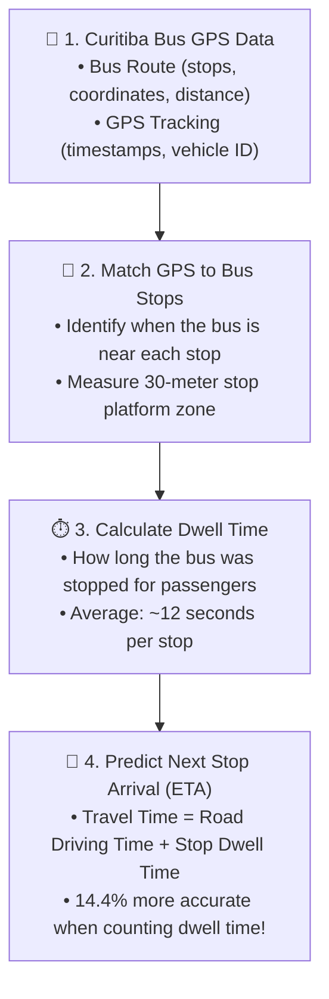

# Simple System Flowchart: Curitiba Bus Travel Time & Dwell Time

This diagram shows the complete 4-step process used in this project in plain, simple terms:

---

## 4-Step Breakdown Explained Simply

### Step 1: Curitiba Bus GPS Data
We use the real-world Curitiba BRT dataset:
* **Bus Itineraries (`bus_itineraries/`):** Tells us the sequence of stops, GPS coordinates, and distances between stops (e.g., Route 021 has 113 stops over 38.1 km).
* **Bus Tracking (`bus_tracking/`):** Real vehicle GPS pings recording where and when each bus was on the road.

### Step 2: Match GPS to Bus Stops
Because GPS pings only arrive every 30 to 60 seconds, a ping rarely hits the exact second the bus arrives at a stop.
We create a **30-meter platform zone** around each stop ($15\text{m}$ before the stop to $15\text{m}$ after the stop).
* If a ping is inside this 30m zone $\to$ the bus is at the stop.
* If a ping is between stops $\to$ the bus is driving on the road.

### Step 3: Calculate Dwell Time
**What is Dwell Time?**
It is the time (in seconds) the bus remains stopped at a station for passengers to get on and off.
* Total Trip Time = (Driving Time on Roads) + (Dwell Time at Stations).
* In our Curitiba test run:
  * **81% of the time** is spent driving on roads.
  * **19% of the time** is spent stopped at stations (dwell time).
  * Average stop dwell time: **~12 seconds**.

### Step 4: Predict Next Stop Arrival (ETA)
Most basic transit apps only look at distance and speed, ignoring how long the bus will stop at stations.
By adding our calculated dwell time into the prediction:
* Error drops from **29.5 seconds** down to **25.2 seconds**.
* Predictions become **+14.4% more accurate**!
